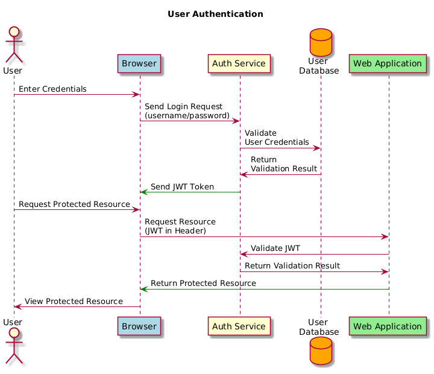

# บทที่4: Analysis Modeling (การสร้างแบบจำลองเชิงวิเคราะห์)
## 1. Requirements Analysis คืออะไร

ก่อนจะสร้างแบบจำลอง เราต้องเข้าใจก่อนว่า **Requirements Analysis** ทำหน้าที่อะไรในกระบวนการพัฒนาซอฟต์แวร์:

- ระบุ **คุณลักษณะเชิงปฏิบัติการ** (operational characteristics) ของซอฟต์แวร์
- บอกว่า software จะ **เชื่อมต่อ (interface)** กับส่วนอื่นของระบบอย่างไร
- กำหนด **ข้อจำกัด (constraints)** ที่ซอฟต์แวร์ต้องปฏิบัติตาม

ในขั้นตอนนี้ วิศวกรซอฟต์แวร์จะสวมบทบาทเป็น **"นักวิเคราะห์" (Analyst/Modeler)** ที่ต้อง:
- ขยายความ requirement เบื้องต้นที่ได้จากขั้นตอนก่อนหน้า
- สร้างแบบจำลอง (models) ที่แสดง user scenario, กิจกรรมเชิงฟังก์ชัน, กลุ่มปัญหาและความสัมพันธ์ระหว่างกัน, พฤติกรรมของระบบ/คลาส และการไหลของข้อมูล

> **แนวคิดสำคัญ:** Analysis Model เปรียบเสมือน **"สะพาน" (Bridge)** ที่เชื่อมระหว่าง "คำอธิบายระบบ (system description)" กับ "แบบจำลองการออกแบบ (design model)"

---

## 2. สองแนวทางหลักของ Analysis Modeling

| แนวทาง | แนวคิดหลัก |
|---|---|
| **Structured Analysis** | แยก "ข้อมูล (data)" กับ "กระบวนการที่แปลงข้อมูล (process)" ออกจากกัน เป็นคนละ entity |
| **Object-Oriented Analysis (OOA)** | มุ่งเน้นการนิยาม **class** และวิธีที่ class ต่างๆ ทำงานร่วมกัน (collaborate) เพื่อตอบสนอง requirement ของลูกค้า |

### Data Modeling (ส่วนหนึ่งของ Structured Analysis)
- พิจารณาข้อมูลแยกจากกระบวนการ (process)
- โฟกัสที่ "data domain"
- สร้างแบบจำลองในระดับที่ลูกค้าเข้าใจได้
- แสดงว่า data object แต่ละตัวสัมพันธ์กันอย่างไร

---

## 3. Flow-Oriented Modeling และ Data Flow Diagram (DFD)

**Flow-Oriented Modeling** แสดงว่าข้อมูลถูก "แปลง" อย่างไรขณะเคลื่อนที่ผ่านระบบ โดยใช้เครื่องมือที่เรียกว่า **DFD (Data Flow Diagram)**

> แม้จะถูกมองว่าเป็นแนวทาง "old school" แต่ DFD ยังมีมุมมองที่มีประโยชน์ ควรใช้ "เสริม" ควบคู่กับแบบจำลองอื่น ไม่ใช่ใช้แทนทั้งหมด

**แนวคิดพื้นฐาน:** ทุกระบบคอมพิวเตอร์คือ "ตัวแปลงข้อมูล" (information transform): **input → computer-based system → output**

### องค์ประกอบของ DFD (4 อย่าง)

1. **Process (กระบวนการ)**
   - กิจกรรมหรือฟังก์ชันที่ทำเพื่อวัตถุประสงค์ทางธุรกิจ
   - อาจทำโดยคนหรือคอมพิวเตอร์
   - ต้องมีชื่อไม่ซ้ำ (verb phrase), หมายเลข, คำอธิบาย
   - ต้องมี **input อย่างน้อย 1 เส้น และ output อย่างน้อย 1 เส้น**

2. **Data Flow (การไหลของข้อมูล)**
   - ข้อมูลชิ้นเดียวหรือกลุ่มข้อมูลเชิงตรรกะ
   - ต้องเริ่มต้นหรือสิ้นสุดที่ process เสมอ
   - ชื่อเป็นคำนาม (noun) และ **ห้ามมีหัวลูกศรสองด้าน**

3. **Data Store (แหล่งเก็บข้อมูล)**
   - ที่เก็บข้อมูลรูปแบบหนึ่ง
   - ข้อมูลไหล**ออก** = การดึงข้อมูล (retrieve)
   - ข้อมูลไหล**เข้า** = การอัปเดต/เพิ่มข้อมูล
   - ต้องมี input และ output อย่างน้อยอย่างละ 1 เส้น

4. **External Entity (หน่วยงานภายนอก)**
   - คน องค์กร หรือระบบที่อยู่ **นอก** ระบบ แต่มีปฏิสัมพันธ์กับระบบ
   - ต้องมี input หรือ output อย่างน้อย 1 เส้น

---

## 4. การแบ่งระดับ DFD (Decomposition)

เนื่องจากกระบวนการทางธุรกิจซับซ้อนเกินกว่าจะแสดงใน DFD แผ่นเดียว จึงใช้ **Decomposition** คือการแบ่งระบบเป็นลำดับชั้นของ DFD:

```
Context Diagram   →  ภาพรวมระบบทั้งหมดเป็น 1 process เดียว
        ↓
Level 0 Diagram   →  แตกเป็น process ย่อยหลายตัว
        ↓
Level 1 Diagram   →  แตกรายละเอียดของแต่ละ process ใน Level 0
        ↓
Level 2 Diagram   →  แตกรายละเอียดลึกลงไปอีก
```

Diagram ลูก (child) จะแสดงส่วนหนึ่งของ diagram แม่ (parent) โดยละเอียดมากขึ้น

### การรวม Use Case เข้ากับ DFD
- DFD เริ่มต้นจาก use case และ requirement ที่นิยามไว้แล้ว
- **ชื่อ use case** → กลายเป็น **process**
- **input/output** → กลายเป็น **data flow**
- data เล็กๆ ที่เกี่ยวข้องกัน ให้รวมเป็น flow เดียว

---

## 5. การตรวจสอบความถูกต้องของ DFD (Validating the DFD)

### 5.1 ตรวจสอบไวยากรณ์ (Syntax) — ภายใน DFD แต่ละแผ่น

**Process:**
- ชื่อไม่ซ้ำ เป็น verb phrase มีหมายเลขและคำอธิบาย
- มี input ≥ 1 และ output ≥ 1
- ชื่อ output ควรต่างจากชื่อ input
- ควรมี **3-7 process** ต่อ 1 แผ่น DFD

**Data Flow:**
- ชื่อไม่ซ้ำ เป็นคำนาม
- เชื่อมต่อกับ process อย่างน้อย 1 จุด
- ทิศทางเดียว (ไม่มีลูกศรสองหัว)
- เส้นตัดกันให้น้อยที่สุด

**Data Store:** ชื่อไม่ซ้ำ (คำนาม), มี input/output อย่างน้อยอย่างละ 1

**External Entity:** ชื่อไม่ซ้ำ (คำนาม), มี input หรือ output อย่างน้อย 1

### 5.2 ตรวจสอบข้าม DFD หลายระดับ (Across DFDs)

| หลักการ | ความหมาย |
|---|---|
| **Context Diagram** | ต้องมี Context Diagram เพียง 1 แผ่นสำหรับทั้งชุด |
| **Viewpoint** | มุมมองต้องสอดคล้องกันตลอดทั้งชุด DFD |
| **Decomposition** | process แต่ละตัวต้องถูกอธิบายครบถ้วนโดย DFD ลูกของมัน |
| **Balance** | data flow/store/entity ใน DFD ระดับบนต้องปรากฏใน DFD ระดับล่างที่แตกออกมา และห้ามมีสิ่งที่ไม่ปรากฏในแผ่นแม่โผล่มาในแผ่นลูก |

### 5.3 ข้อผิดพลาดที่พบบ่อย (Common Errors)
- **No process to move data flow** — data flow ที่ไม่มี process ขับเคลื่อน
- **Miracle process** — process ที่ไม่มี input (จู่ๆ ก็มี output)
- **Black hole** — process ที่ไม่มี output (มีแต่ input)
- **Data store ไม่มี input หรือไม่มี output**
- **Output มีชื่อซ้ำกับ input**
- **Data flow มีหัวลูกศรสองด้าน**

---

## 6. Process Specification (PSPEC)

เมื่อ process (bubble) ใน DFD ถูกแตกจนถึงระดับล่างสุดแล้ว จะต้องอธิบายรายละเอียดการทำงานภายในด้วย **PSPEC** ซึ่งอาจประกอบด้วย:
- คำบรรยาย (narrative)
- pseudocode (PDL)
- สมการ (equations)
- ตาราง (tables)
- แผนภาพ/ชาร์ต (diagrams/charts)

---

## 7. แนวคิด Object-Oriented (OO Concepts)

แนวคิดพื้นฐานที่ต้องเข้าใจก่อนสร้าง class-based analysis model:
- **Class และ Object**
- **Attribute และ Operation**
- **Encapsulation และ Instantiation**
- **Inheritance**

### 7.1 Class และ Object — จุดเริ่มต้นของทุกอย่าง

**Class** คือ "แม่แบบ" หรือ "พิมพ์เขียว" (template/blueprint) ที่ใช้อธิบายกลุ่มของสิ่งที่มีลักษณะคล้ายกัน เช่น class "Student" คือแม่แบบที่บอกว่านักเรียนทุกคนต้องมีชื่อ รหัสนักศึกษา และทำอะไรได้บ้าง

ส่วน **Object** คือ ตัวอย่างจริงที่ถูกสร้างขึ้นมาจาก class นั้น (เรียกว่า **instance**) เช่น นักเรียนชื่อ "สมชาย" คือ object หนึ่งตัวของ class Student

> เปรียบเทียบง่ายๆ: Class = แบบพิมพ์คุกกี้ (cookie cutter), Object = คุกกี้แต่ละชิ้นที่ตัดออกมาจากแบบนั้น

**Instantiation** คือ กระบวนการสร้าง object ขึ้นมาจาก class (การ "ตัดคุกกี้" ออกมาจากแบบพิมพ์นั่นเอง)

### 7.2 Analysis Class มาจากไหนบ้าง — 7 แหล่งที่มา

เวลาวิเคราะห์ปัญหาจริง เราจะหา class ได้จาก 7 แหล่งนี้ (ควรท่องให้ขึ้นใจ เพราะข้อสอบมักถามว่า "สิ่งนี้ควรเป็น class ประเภทไหน"):

| ประเภท | ตัวอย่าง | อธิบายง่ายๆ |
|---|---|---|
| **External entities** | ระบบอื่น, อุปกรณ์, คน | สิ่งที่อยู่นอกระบบแต่ส่ง/รับข้อมูลกับระบบ |
| **Things** | รายงาน, จอแสดงผล, จดหมาย, สัญญาณ | วัตถุที่เป็นส่วนหนึ่งของข้อมูลในปัญหา |
| **Occurrences/Events** | การโอนกรรมสิทธิ์, การเคลื่อนที่ของหุ่นยนต์เสร็จสิ้น | เหตุการณ์ที่เกิดขึ้น ณ ช่วงเวลาหนึ่ง |
| **Roles** | ผู้จัดการ, วิศวกร, พนักงานขาย | บทบาทที่คนสวมใส่ตอนใช้ระบบ |
| **Organizational units** | แผนก, ทีม, กลุ่ม | หน่วยงานที่เกี่ยวข้องกับระบบ |
| **Places** | โรงงาน, ท่าขนถ่ายสินค้า | สถานที่ที่กำหนดบริบทของปัญหา |
| **Structures** | เซนเซอร์, รถ 4 ล้อ, คอมพิวเตอร์ | อุปกรณ์/วัตถุที่นิยาม class ของกลุ่มวัตถุ |

**เทคนิคจำ:** เวลาอ่านโจทย์ ให้ขีดเส้นใต้คำนามทั้งหมดในเอกสาร requirement แล้วเช็คว่าคำนามแต่ละคำเข้าข่ายแหล่งไหนใน 7 ข้อนี้ — นั่นแหละคือตัวเลือก class ที่เป็นไปได้

### 7.3 Encapsulation (การห่อหุ้ม) — หัวใจของ OO

แนวคิดนี้บอกว่า object หนึ่งตัวจะ **ห่อหุ้มทั้งข้อมูล (data) และวิธีการจัดการข้อมูลนั้น (methods) ไว้ด้วยกันเป็นก้อนเดียว**
```
ลองนึกภาพ:
    ┌────────────────────────────┐
    │   method #1   method #2    │
    │           ┌──────┐         │
    │  method #6│ data │method #3│
    │           └──────┘         │
    │   method #5   method #4    │
    └────────────────────────────┘
```
data อยู่ตรงกลาง ถูกล้อมรอบด้วย method ต่างๆ ที่ทำหน้าที่เข้าถึง/แก้ไข data นั้น

ผลลัพธ์ที่ได้คือ **Information Hiding** — คนภายนอกไม่สามารถเข้าถึง data ได้โดยตรง ต้องผ่าน method ที่ object กำหนดไว้เท่านั้น เช่น เราแก้ยอดเงินในบัญชีธนาคารไม่ได้โดยตรง ต้องเรียกผ่าน method อย่าง `withdraw()` หรือ `deposit()` เท่านั้น

> ทำไมสำคัญ: ป้องกันไม่ให้ข้อมูลถูกแก้ไขมั่วซั่วจากภายนอก และทำให้เปลี่ยนแปลงวิธีเก็บข้อมูลภายในได้โดยไม่กระทบโค้ดส่วนอื่น

### 7.4 Method (Operation/Service)

Method คือ **กระบวนการที่ทำงานได้ (executable procedure)** ที่ถูกห่อหุ้มอยู่ใน class และถูกออกแบบมาให้ทำงานกับ attribute หนึ่งตัวหรือมากกว่านั้นที่กำหนดไว้ใน class นั้น

การเรียกใช้ method ทำผ่าน **message passing** — พูดง่ายๆ คือ object หนึ่งจะ "ส่งข้อความ" ไปบอก object อีกตัวว่า "ช่วยทำงานอันนี้ให้หน่อย" ซึ่งจริงๆ ก็คือการเรียก method นั่นเอง

### 7.5 Class Diagram — วิธีวาดออกมาเป็นภาพ

Class Diagram แบ่งเป็น 3 ช่องเสมอ:
```
┌─────────────────────┐
│     ชื่อ Class        │
├─────────────────────┤
│     Attributes      │  ← ข้อมูล
├─────────────────────┤
│     Operations      │  ← พฤติกรรม/เมธอด
└─────────────────────┘
```

สังเกตว่า attribute คือ "นาม" (noun) และ operation คือ "กริยา" (verb) — เทคนิคจำง่ายๆ

### 7.6 ประเภทของ Class ตามหน้าที่ (Class Types)

นี่คือส่วนที่มักออกสอบบ่อย เพราะเป็นการแบ่ง class ตาม **บทบาทในสถาปัตยกรรมของระบบ** (ไม่ใช่แบ่งตามที่มาแบบข้อ 7.2):

1. **Entity class** (หรือเรียกว่า model/business class)
   - ดึงมาจากคำอธิบายปัญหาโดยตรง
   - เช่น `FloorPlan`, `Sensor`
   - เก็บข้อมูลหลักของระบบ (มักจะอยู่ในฐานข้อมูล)

2. **Boundary class**
   - สร้างส่วนติดต่อ (interface) ที่ผู้ใช้มองเห็นและโต้ตอบด้วย
   - เช่น หน้าจอโต้ตอบ (interactive screen), รายงานที่พิมพ์ออกมา
   - เป็น "ด่านหน้า" ที่คุยกับผู้ใช้หรือระบบภายนอก

3. **Controller class**
   - บริหารจัดการ "หนึ่งหน่วยงาน" (unit of work) ตั้งแต่ต้นจนจบ
   - หน้าที่หลักๆ คือ:
     - สร้างหรืออัปเดต entity object
     - สร้าง (instantiate) boundary object ตอนที่ต้องดึงข้อมูลจาก entity object
     - จัดการการสื่อสารที่ซับซ้อนระหว่างกลุ่ม object
     - ตรวจสอบความถูกต้อง (validate) ของข้อมูลที่สื่อสารระหว่าง object หรือระหว่างผู้ใช้กับแอปพลิเคชัน

> **ตัวอย่างจากสไลด์ (2BWatch — นาฬิกาดิจิทัล):**
> - Entity classes: `Year`, `Month`, `Day`
> - Control class: `ChangeDate`
> - Interface (Boundary) classes: `Button`, `LCDDisplay`

**ทำไมต้องแบ่งแบบนี้?** เพราะช่วยแยกความรับผิดชอบ (separation of concerns) — ถ้าจะเปลี่ยนหน้าจอ (UI) ก็แก้แค่ boundary class ไม่ต้องยุ่งกับ entity class ที่เก็บข้อมูลจริง

### 7.7 ความสัมพันธ์ระหว่าง Class (Class Relationships)

ความสัมพันธ์มีทั้งหมด 5 แบบ เรียงจาก **อ่อนแอที่สุด (dependency) ไปจนถึงแข็งแรงที่สุด (inheritance)**:
```
อ่อนแอ ◄──────────────────────────────► แข็งแรง
Dependency → Association → Aggregation → Composition → Inheritance
```

| ความสัมพันธ์ | สัญลักษณ์ | ความหมาย | ตัวอย่าง |
|---|---|---|---|
| **Dependency** | เส้นประ + ลูกศร (- - ->) | Object ของ class หนึ่ง "ทำงานร่วมกับ" object ของอีก class แบบ**สั้นๆ ชั่วคราว** | ฟังก์ชันหนึ่งเรียกใช้อีก class เพียงครั้งเดียวเพื่อคำนวณบางอย่าง |
| **Association** | เส้นตรงธรรมดา (───) | Object ทำงานร่วมกัน**เป็นระยะเวลานาน** | นักเรียนกับอาจารย์ที่ปรึกษา |
| **Aggregation** | เส้น + สี่เหลี่ยมข้าวหลามตัด**กลวง** (◇───) | Class หนึ่ง "เป็นเจ้าของ" แต่แค่ **ใช้ reference ร่วม** กับอีก class (แยกออกจากกันได้ ยังมีชีวิตอยู่ได้เอง) | ทีมฟุตบอล "มี" ผู้เล่น แต่ผู้เล่นก็ยังเป็นคนที่มีตัวตนอยู่ได้แม้ไม่มีทีม |
| **Composition** | เส้น + สี่เหลี่ยมข้าวหลามตัด**ทึบ** (◆───) | Class หนึ่ง "บรรจุ" object ของอีก class ไว้ในตัวเอง (ถ้า class แม่ตายไป ลูกก็ตายไปด้วย) | บ้าน "ประกอบด้วย" ห้อง — ถ้าบ้านถูกทำลาย ห้องก็หายไปด้วย |
| **Inheritance** | เส้น + ลูกศร**กลวง** (◁───) | Class หนึ่ง**เป็นชนิดหนึ่ง (is-a)** ของอีก class | `Dog` เป็นชนิดหนึ่งของ `Animal` |

> **จุดสังเกตสำคัญ:** ยิ่งความสัมพันธ์ "แข็งแรง" เท่าไหร่ ยิ่งหมายความว่า object ทั้งสองผูกติดกันแน่นขึ้นเท่านั้น — Aggregation กับ Composition ต่างกันตรงที่ **"อายุการมีชีวิต" (lifecycle)** ของ object ลูกขึ้นกับ object แม่หรือไม่
---

## 8. Scenario-Based Modeling (Use Case)

> "Use-case เป็นเพียงเครื่องมือช่วยระบุว่าอะไรอยู่ **นอก** ระบบ (actor) และอะไรควรถูก **ระบบทำ** (use case)" — Ivar Jacobson

**Use Case** คือ สถานการณ์ที่อธิบาย "เส้นทางการใช้งาน" (thread of usage) ของระบบ
**Actor** คือ บทบาทที่คนหรืออุปกรณ์เล่นในระบบ (ผู้ใช้คนเดียวอาจเล่นได้หลายบทบาท)

### 8.1 Use Case Diagram
- สรุป use case ทั้งหมด (เฉพาะส่วนที่กำลังโมเดล) ไว้ในภาพเดียว
- มักวาดตั้งแต่ช่วงต้นของ SDLC
- แสดงความสัมพันธ์ระหว่าง actor กับ use case

### 8.2 องค์ประกอบของ Use Case Diagram



| องค์ประกอบ | ความหมาย |
|---|---|
| **Use Case** (วงรี) | ตัวแทนฟังก์ชันหลักของระบบ |
| **Actor** (รูปคน) | คน/ระบบภายนอกที่ได้รับประโยชน์จากระบบ |
| **Communication line** (เส้นเชื่อม) | เชื่อม actor กับ use case ที่เกี่ยวข้อง (ไม่ได้บอกทิศทางการไหลของข้อมูล) |
| **System boundary** (กรอบสี่เหลี่ยม) | แสดงขอบเขตของระบบ — use case อยู่ใน กรอบ, actor อยู่ **นอก** กรอบ |

> ตัวอย่าง: ระบบ "Appointment System" มี use case เช่น make appointment (เชื่อมกับ Patient), Produce schedule information (เชื่อมกับ Management), Record Availability (เชื่อมกับ Doctor)

### 8.3 ความสัมพันธ์ระหว่าง Use Case (Use Case Relationships)
เพื่อลดความซ้ำซ้อนระหว่างคำอธิบาย use case และแสดงพฤติกรรมที่นำกลับมาใช้ซ้ำได้ (reusable) หรือเป็นทางเลือก (optional):

- **`<<include>>`** — use case ปลายลูกศร (ที่ถูกชี้ถึง) จะถูก "ใช้ซ้ำทั้งหมด" โดย use case ต้นทาง (บังคับเสมอ)
- **`<<extend>>`** — คล้าย include แต่เป็น **ทางเลือก (optional)** ขึ้นอยู่กับเงื่อนไข runtime หรือการตัดสินใจ

> ตัวอย่าง: "Make appointment" ถูก extend โดย "Update patient information" (ทำหรือไม่ก็ได้) และ "Manage schedule" ถูก include โดยทั้ง "Produce schedule information" และ "Record availability" (ต้องทำเสมอ)

---

## 9. Behavioral Modeling (การสร้างแบบจำลองพฤติกรรม)

ขั้นตอนหลักในการทำ Behavioral Modeling:
1. ระบุ **สถานะ (state)** ต่างๆ ของระบบ (ระบบมีพฤติกรรมอย่างไร)
2. ระบุว่าระบบ **เปลี่ยนสถานะ (transition)** อย่างไร (มี event และ action อะไรบ้าง)
3. วาด **State Diagram** หรือ **Sequence Diagram**

### 9.1 Sequence Diagram
- ต่อยอดจาก flow of events ใน use case
- เป็นแผนภาพแสดง object ที่เกี่ยวข้องในการทำ use case โดยใช้รูปแบบ **DAG (Directed Acyclic Graph)**
- Object/class ถูกระบุไว้แล้วจากขั้นตอน object modeling; ส่วน "การกระทำ/เหตุการณ์" มาจาก dynamic modeling

**หลักการสำคัญ:** ทุก event มี **ผู้ส่ง (sender)** และ **ผู้รับ (receiver)** เสมอ — การแสดง event นี้เรียกว่า **message**

### 9.2 หลักการจัดวาง (Heuristics) ของ Sequence Diagram

**การจัดคอลัมน์ (Layout):**
1. คอลัมน์แรก = **actor** ที่เริ่ม use case
2. คอลัมน์ที่สอง = **boundary object**
3. คอลัมน์ที่สาม = **control object** ที่บริหารส่วนที่เหลือของ use case

**การสร้าง (Creation):**
- Control object ถูกสร้างขึ้นตอนเริ่ม use case
- Boundary object ถูกสร้างโดย control object

**การเข้าถึง (Access):**
- Entity object ถูกเข้าถึงโดย control และ boundary object
- **Entity object ห้ามเรียก** boundary หรือ control object กลับ (ทางเดียว)

### 9.3 องค์ประกอบสัญลักษณ์ของ Sequence Diagram
| สัญลักษณ์ | ความหมาย |
|---|---|
| ลูกศรทึบ (solid arrow) | Synchronous Message |
| ลูกศรหัวเปิด (open arrow) | Asynchronous Message |
| เส้นประ + ลูกศร | Return Message |
| `<<create>>` | Participant Creation Message |
| `<<destroy>>` + เครื่องหมาย X | Participant Destruction Message |
| เส้นแนวตั้ง | Lifeline ของ object |
| แท่งสี่เหลี่ยมบาง (activation) | ช่วงเวลาที่ object กำลังทำงาน |

**Nested Message:**
- ต้นทางของลูกศร = activation ที่ส่ง message นั้น
- 1 activation จะยาวครอบคลุม activation ย่อยทั้งหมดที่ซ้อนอยู่ข้างใน
- เส้นประแนวนอน = การไหลของข้อมูล (dataflow)


**Creation & Destruction:**
- **สร้าง object** → ลูกศรชี้เข้าหา object นั้น
- **ทำลาย object** → เครื่องหมาย **X** ที่ปลาย activation


### 9.4 รูปแบบการกระจายพฤติกรรม (Fork vs Stair Diagram)
| รูปแบบ | ลักษณะ |
|---|---|
| **Fork Diagram** | พฤติกรรมส่วนใหญ่กระจุกอยู่ที่ **object เดียว** (มักเป็น control object) ที่รู้จัก object อื่นทั้งหมดและสั่งงานโดยตรง |
| **Stair Diagram** | พฤติกรรมถูก **กระจาย** ออกไป — แต่ละ object รู้จักเพียงบาง object และมอบหมายงานต่อกันเป็นทอดๆ |

---

## สรุปภาพรวมทั้งหมด

```
Analysis Modeling
│
├── Structured Analysis
│   ├── Data Modeling (ข้อมูล)
│   └── Flow-Oriented Modeling → DFD (process, data flow, data store, external entity)
│       └── Decomposition → Context → Level 0 → Level 1 → Level 2 ...
│       └── Validation (syntax + across-DFD) + PSPEC
│
└── Object-Oriented Analysis
    ├── Class-Based Modeling (class, attribute, operation, encapsulation, relationships)
    ├── Scenario-Based Modeling (use case, actor, include/extend)
    └── Behavioral Modeling (state diagram, sequence diagram)
```

**ประเด็นสำคัญที่ควรจำ:**
1. Structured Analysis แยกข้อมูลกับกระบวนการ ส่วน OO Analysis รวมข้อมูลกับพฤติกรรมไว้ใน class เดียวกัน (encapsulation)
2. DFD ต้องผ่านการตรวจสอบทั้งภายในแผ่นเดียว (syntax) และข้ามระหว่างแผ่น (balance, decomposition, viewpoint)
3. Use Case Diagram เน้นแสดง "ใครทำอะไรกับระบบ" ส่วน Sequence Diagram เน้นแสดง "ลำดับการส่งข้อความระหว่าง object" ในการทำ use case หนึ่งๆ
4. ทั้งหมดนี้คือ "สะพาน" เชื่อมจาก requirement ของลูกค้า ไปสู่แบบจำลองการออกแบบ (design model) ในขั้นตอนถัดไป