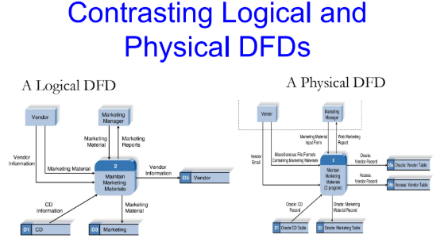

# บทที่ 5: Design Engineering (วิศวกรรมการออกแบบซอฟต์แวร์)
## 1. Software Design คืออะไร

**Design (การออกแบบ)** คือการนำเสนอเชิงวิศวกรรมที่มีความหมาย ของสิ่งที่เราจะสร้างขึ้น โดยต้อง:

- สามารถย้อนกลับไปเชื่อมโยงกับ **ความต้องการของลูกค้า (customer's requirements)** ได้
- สามารถประเมินคุณภาพได้ตามเกณฑ์ที่กำหนดไว้ล่วงหน้าว่าเป็น "การออกแบบที่ดี"

ในบริบทของวิศวกรรมซอฟต์แวร์ การออกแบบจะโฟกัสใน 4 ด้านหลัก:

| ด้าน | ความหมาย |
|---|---|
| **Data** | โครงสร้างข้อมูล |
| **Architecture** | สถาปัตยกรรมของระบบ |
| **Interface** | การเชื่อมต่อสื่อสาร |
| **Component** | ส่วนประกอบย่อยของโปรแกรม |

---

## 2. พื้นที่โฟกัสของการออกแบบซอฟต์แวร์

### 2.1 Data Design
เปลี่ยน **Information Domain Model** (ที่สร้างขึ้นตอนวิเคราะห์ระบบ) ให้กลายเป็น **โครงสร้างข้อมูล (data structures)** ที่จะใช้จริงตอนพัฒนาโปรแกรม โดยอ้างอิงจาก:
- Entity Relationship Diagram (ความสัมพันธ์ของข้อมูล)
- Data Dictionary (รายละเอียดข้อมูล)

### 2.2 Architectural Design
กำหนด**ความสัมพันธ์ระหว่างองค์ประกอบโครงสร้างหลัก**ของซอฟต์แวร์ เช่น โมดูลต่าง ๆ เชื่อมกันอย่างไร

### 2.3 Interface Design
อธิบายว่าซอฟต์แวร์สื่อสารกันอย่างไร ทั้ง:
- ภายในตัวมันเอง
- กับระบบอื่นที่ทำงานร่วมกัน (interoperate)
- กับมนุษย์ที่ใช้งาน (ผู้ใช้)

### 2.4 Component-Level Design
แปลงโครงสร้างของสถาปัตยกรรมซอฟต์แวร์ให้เป็น**คำอธิบายเชิงกระบวนการ (procedural description)** ของแต่ละ component

> **Component** คือชิ้นส่วนโปรแกรมที่ค่อนข้างเป็นอิสระ มีชื่อ มีคำสั่งของตัวเอง และมีข้อมูลของตัวเอง (เช่น method, class, package)

---

## 3. จาก Analysis Model สู่ Design Model

กระบวนการพัฒนาซอฟต์แวร์จะเริ่มจาก **Analysis Model** ก่อน แล้วจึงแปลงไปเป็น **Design Model**

**Analysis Model** ประกอบด้วย 4 กลุ่มองค์ประกอบ:
1. **Scenario-based elements** — use case ต่าง ๆ, use-case diagram, activity diagram, swim lane diagram
2. **Flow-oriented elements** — data flow diagram, control-flow diagram, processing narrative
3. **Class-based elements** — class diagram, CRC model, collaboration diagram
4. **Behavioral elements** — state diagram, sequence diagram

องค์ประกอบเหล่านี้จะถูกแปลงไปเป็น **Design Model** ซึ่งประกอบด้วย:
- **Data/Class Design**
- **Architectural Design**
- **Interface Design**
- **Component-Level Design**


---

## 4. การออกแบบที่มีคุณภาพ (Design and Quality)

การออกแบบที่ดีต้อง:

1. **ครบถ้วน** — ตอบสนองความต้องการที่ระบุไว้ชัดเจน (explicit) และความต้องการแฝงที่ลูกค้าคาดหวัง (implicit)
2. **อ่านเข้าใจง่าย** — เป็นแนวทางที่ชัดเจนสำหรับคนเขียนโค้ด คนทดสอบ และคนดูแลระบบต่อ
3. **ให้ภาพรวมที่สมบูรณ์** — ครอบคลุมทั้งด้านข้อมูล (data) ฟังก์ชัน (functional) และพฤติกรรม (behavioral) ในมุมมองของการนำไปปฏิบัติจริง

---

## 5. แนวคิดพื้นฐาน (Fundamental Concepts)

| แนวคิด | ความหมาย |
|---|---|
| **Abstraction** | การนามธรรมของข้อมูล กระบวนการ และการควบคุม |
| **Architecture** | โครงสร้างโดยรวมของซอฟต์แวร์ |
| **Patterns** | รูปแบบการแก้ปัญหาที่พิสูจน์แล้วว่าใช้ได้ผล |
| **Modularity** | การแบ่งข้อมูลและฟังก์ชันออกเป็นส่วน ๆ ทำให้สร้าง แก้ไข และซ่อมง่ายขึ้น |
| **Hiding** | การควบคุมอินเทอร์เฟซที่เปิดเผยออกไป (ซ่อนรายละเอียดภายใน) |
| **Functional Independence** | แต่ละโมดูลทำหน้าที่เดียวชัดเจน และมี coupling ต่ำ |
| **Refinement** | การขยายรายละเอียดของสิ่งที่เป็นนามธรรม |
| **Refactoring** | การจัดระเบียบโค้ด/ดีไซน์ใหม่ให้ดีขึ้น โดยไม่เปลี่ยนพฤติกรรมภายนอก |

### ตัวอย่าง Data Abstraction
วัตถุ "**door (ประตู)**" สามารถแทนด้วยโครงสร้างข้อมูลที่ประกอบด้วย: ผู้ผลิต, รุ่น, ประเภท, ทิศทางการเปิด ฯลฯ — นี่คือการมองวัตถุจริงให้กลายเป็นข้อมูลนามธรรม

### ตัวอย่าง Procedural Abstraction
คำสั่ง "**open (เปิด)**" ถูกนำไปใช้โดยที่เราไม่ต้องรู้รายละเอียดภายในของฟังก์ชัน "enter" — เราแค่เรียกใช้มันได้เลย

---

## 6. Architecture (สถาปัตยกรรมซอฟต์แวร์)

นิยาม: "โครงสร้างโดยรวมของซอฟต์แวร์ และวิธีการที่โครงสร้างนั้นให้ความสมบูรณ์เชิงแนวคิดแก่ระบบ"

สถาปัตยกรรมที่ดีต้องพิจารณา 3 คุณสมบัติ:

1. **Structural properties** — กำหนดองค์ประกอบของระบบ (โมดูล, object, filter) และวิธีที่มันบรรจุรวมกันและมีปฏิสัมพันธ์กัน
2. **Extra-functional properties** — ต้องตอบโจทย์เรื่อง performance, capacity, reliability, security, adaptability
3. **Families of related systems** — ควรนำรูปแบบที่ใช้ซ้ำได้ (reusable pattern) มาใช้กับระบบที่คล้ายกัน เพื่อให้นำ building block กลับมาใช้ใหม่ได้

---

## 7. Functional Independence (ความเป็นอิสระเชิงฟังก์ชัน)

โมดูลที่เป็นอิสระจากกันจะ**ดูแลรักษาและทดสอบง่ายกว่า** เพราะผลกระทบข้างเคียงจากการแก้ไขจะจำกัดวงแคบ และลดการแพร่กระจายของข้อผิดพลาด

### Cohesion (ความเชื่อมโยงภายในโมดูล)
- โมดูลที่มี **cohesion สูง** จะทำหน้าที่เดียวอย่างชัดเจน โดยไม่ต้องพึ่งพาส่วนอื่นมากนัก
- ยิ่ง cohesion สูง ยิ่งดี

### Coupling (ความเชื่อมโยงระหว่างโมดูล)
- **Coupling** คือระดับความเชื่อมโยงระหว่างโมดูลต่าง ๆ ขึ้นอยู่กับความซับซ้อนของ interface, จุดเชื่อมต่อ และข้อมูลที่ส่งผ่านกัน
- ประเภทของ coupling ได้แก่: Data coupling, Stamp coupling, Control coupling, External coupling, Common coupling
- ยิ่ง coupling **ต่ำ** ยิ่งดี (โมดูลไม่ยุ่งเกี่ยวกันมากเกินไป)

**หลักการสำคัญ: ออกแบบให้ Cohesion สูง + Coupling ต่ำ**

---

## 8. Information Hiding (การซ่อนสารสนเทศ)

แนวคิด: โมดูลแต่ละตัวจะมี **"ความลับ" (secret)** ของตัวเอง เช่น:
- อัลกอริทึม (algorithm)
- โครงสร้างข้อมูล (data structure)
- รายละเอียดของ interface ภายนอก
- นโยบายการจัดสรรทรัพยากร

ผู้ใช้ (clients) จะเข้าถึงโมดูลผ่าน **controlled interface** เท่านั้น โดยไม่เห็นรายละเอียดภายใน

### ทำไมต้องซ่อนสารสนเทศ?
- ลดโอกาสเกิด "side effects" ที่ไม่คาดคิด
- จำกัดผลกระทบของการตัดสินใจออกแบบในระดับ local
- เน้นการสื่อสารผ่าน interface ที่ควบคุมได้
- ลดการใช้ global data
- นำไปสู่ **encapsulation** ซึ่งเป็นคุณสมบัติของการออกแบบที่มีคุณภาพสูง
- ผลลัพธ์คือซอฟต์แวร์คุณภาพสูงขึ้น

---

## 9. Stepwise Refinement (การขยายรายละเอียดทีละขั้น)

เป็นเทคนิคการค่อย ๆ แตกคำสั่งระดับสูงให้เป็นรายละเอียดย่อยลงเรื่อย ๆ

**ตัวอย่าง:** คำสั่ง "open (เปิดประตู)" สามารถขยายเป็น:
```
walk to door
reach for knob
open door        →  ขยายต่อเป็น:
                     repeat until door opens
                       turn knob clockwise
                       if knob doesn't turn then
                         take key out, find correct key, insert in lock
                       pull/push door
                       move out of way
                     end repeat
walk through
close door
```

นี่คือการค่อย ๆ ลงรายละเอียดจากภาพกว้าง ไปสู่ขั้นตอนที่ปฏิบัติได้จริง

---

## 10. Refactoring

ตามคำนิยามของ Fowler: **"Refactoring คือกระบวนการเปลี่ยนแปลงระบบซอฟต์แวร์ โดยไม่เปลี่ยนพฤติกรรมภายนอกของโค้ด/ดีไซน์ แต่ปรับปรุงโครงสร้างภายในให้ดีขึ้น"**

เมื่อ refactor เราจะตรวจสอบดีไซน์เดิมเพื่อหา:
- ความซ้ำซ้อน (redundancy)
- องค์ประกอบดีไซน์ที่ไม่ได้ใช้
- อัลกอริทึมที่ไม่มีประสิทธิภาพหรือไม่จำเป็น
- โครงสร้างข้อมูลที่สร้างไม่ดีหรือไม่เหมาะสม
- ข้อบกพร่องอื่น ๆ ในการออกแบบที่แก้ไขได้

---

## 11. องค์ประกอบของ Design Model

| องค์ประกอบ | รายละเอียด |
|---|---|
| **Data elements** | Data model → โครงสร้างข้อมูล และสถาปัตยกรรมฐานข้อมูล |
| **Architectural elements** | มาจาก application domain, การแปลง analysis class ต่าง ๆ ให้เป็น design realization, และการใช้ pattern/style |
| **Interface elements** | UI (ผู้ใช้), interface ภายนอก (ระบบ/อุปกรณ์/เครือข่ายอื่น), interface ภายในระหว่าง component ต่าง ๆ |
| **Component elements** | โครงสร้างข้อมูลของแต่ละ local data object, อัลกอริทึมของแต่ละ component, และ interface ที่ให้เข้าถึง behavior ของ component |
| **Deployment elements** | วิธีที่ฟังก์ชันและ subsystem ต่าง ๆ ถูกจัดวางบนสภาพแวดล้อมทางกายภาพจริง |

---

## 12. Logical DFD vs Physical DFD

การเปรียบเทียบ Data Flow Diagram สองแบบ:

- **Logical DFD** — แสดง**สิ่งที่ระบบทำ**ในเชิงแนวคิด โดยไม่สนใจว่าจะ implement อย่างไร เช่น "Vendor Information" ไหลเข้าสู่กระบวนการ "Maintain Marketing Materials"
- **Physical DFD** — แสดง**วิธีการ implement จริง** เช่น ระบุว่าใช้ฟอร์มอะไร ใช้ email อะไร เก็บในตาราง Oracle หรือ Access ตารางไหน

**สรุปง่าย ๆ:** Logical DFD บอกว่า "ทำอะไร" ส่วน Physical DFD บอกว่า "ทำอย่างไรในทางเทคนิค"


---

## สรุปภาพรวมทั้งหมด

Design Engineering คือขั้นตอนที่นำ **Analysis Model** (ผลจากการวิเคราะห์ความต้องการ) มาแปลงเป็น **Design Model** ที่มีรายละเอียดเพียงพอสำหรับนำไป implement จริง โดยยึดหลัก:

- แบ่งงานออกแบบเป็น 4 ด้าน: Data, Architecture, Interface, Component
- ใช้แนวคิดพื้นฐานอย่าง abstraction, modularity, information hiding, functional independence
- มุ่งเน้น **cohesion สูง / coupling ต่ำ** เพื่อให้ระบบดูแลรักษาง่าย
- ใช้ stepwise refinement เพื่อขยายรายละเอียดทีละขั้น
- ใช้ refactoring เพื่อปรับปรุงคุณภาพของดีไซน์อย่างต่อเนื่อง